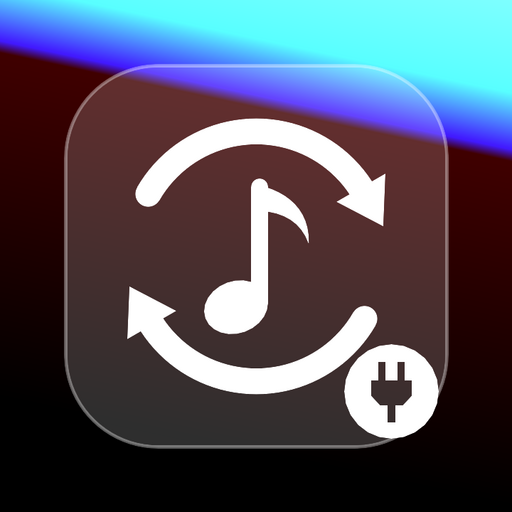

<p align="center"></p>

<h1 align="center">Trackhop Bridge</h1>

<p align="center"><b>More music services for Trackhop, without developer accounts.</b><br>
YouTube Music, Amazon Music, Spotify and Apple Music through their own web players. Your sign-ins stay on your phone.</p>

<p align="center">
  <a href="https://github.com/xlollx/Trackhop-Bridge/releases/latest"></a>
  <a href="https://github.com/xlollx/Trackhop-Bridge/releases"></a>
  <a href="LICENSE"></a>
  
</p>

<p align="center">
  <a href="https://apps.obtainium.imranr.dev/redirect?r=obtainium://add/https://github.com/xlollx/Trackhop-Bridge"></a>
</p>

Optional companion app for [Trackhop](https://github.com/xlollx/Trackhop). It connects music services
that have no open API, or whose official route is heavy for a single user, through the same web
interfaces their own players use. Trackhop discovers this app when installed and offers those
services; it never includes, downloads or installs it.

> **Songport Bridge is now Trackhop Bridge**, because Songport is now Trackhop. Same app, same code,
> same updates. The name changed because an unrelated service called "SongPort", a music link
> converter, works in the same space, and two apps with one name confuse people. Your installed Bridge
> updates normally and keeps its sign-ins; only the name and the look changed. The package id
> (`com.xlollx.songport.ytmbridge`), this repository's address and the release file names
> (`SongportYtmBridge-vX.apk`) stay as they were, so existing installs and update tools keep working.

> **Using Trackhop from GitHub or F-Droid? You do not need this app.** These connectors are built into
> those versions: add the service in Trackhop's Accounts and sign in there. The Bridge is kept for the
> Google Play version of Trackhop, which contains official APIs only.

It is distributed **only here, as an APK**, never on Google Play. The Trackhop build on Google Play
uses only official APIs and never mentions or links to this app.

| Service | What it adds | Official route in Trackhop |
|---------|--------------|----------------------------|
| YouTube Music | playlists, liked songs, search, create, add, remove, reorder, rename, delete, without a Google Cloud project and without quota | YouTube Data API v3 with your own key (10,000 units/day) |
| Amazon Music | playlists, search, create, add, remove, delete | none: Amazon's Web API is a closed beta for approved partners |
| Spotify | your playlists through the web player, without registering a developer app and without Premium | OAuth with your own client ID |
| Apple Music | sign-in without the Apple Developer Program | MusicKit with your own developer token (99 €/year) |

## Read this before installing

- These are **not official APIs**. Using them is against the terms of service of Google/YouTube,
  Amazon, Spotify and Apple, which require access through the interfaces they provide.
- They **can stop working at any time**: the services change their internal responses without notice.
  When that happens, syncs fail until a new Bridge release is published.
- In the worst case a service could **restrict the account** you sign in with. Use accounts you can
  afford to lose, and prefer the official routes for anything important.
- The app shows a disclaimer and asks you to accept it before the first sign-in, and the notice stays
  readable from the main screen.
- Nothing here bypasses authentication or touches anyone else's data: you sign in to your own
  accounts, on the services' own pages, and the app reads and edits your own playlists.
- **Your passwords are never seen or stored.** You type them only on the services' pages inside the
  WebView. What the app keeps is the session (cookies), encrypted with the Android Keystore.

## Where the code comes from

The connectors are developed in Trackhop, where they are the `:bridge` and `:ytm` modules of its
GitHub and F-Droid build. This app carries **the same code**: `android/bridge` and `android/ytm` are
copies made by `scripts/sync-from-trackhop.sh` (the only change: messages name "Trackhop Bridge"), and
`android/UPSTREAM` records the Trackhop commit they come from. Do not edit them here: fix them in
Trackhop, then run

```bash
scripts/sync-from-trackhop.sh ../Trackhop   # path to a Trackhop checkout
```

and commit the result. What belongs to this app alone is `android/app`: the main screen, the
`BridgeProvider` that answers Trackhop, and the manifest that exports the sign-in screens.

## How each connector works

### YouTube Music

A WebView opens accounts.google.com; when Google lands on music.youtube.com the session cookies are
stored encrypted. Requests go to `youtubei/v1/...` signed with `SAPISIDHASH`, carrying the visitor id
and client version read from the player page so they look like the player's own. They are issued as
`fetch()` calls from a hidden WebView parked on a tiny page of music.youtube.com: Google's abuse
detection ("Sorry..." pages, HTTP 403) keys on the client's TLS and HTTP fingerprint, which a plain
HTTP library cannot imitate and a Chrome engine has by nature. Plain HTTP remains the fallback. Calls
are paced, on separate lanes for signed-in calls and anonymous searches; catalogue searches run
**anonymously** where they can, so a long sync does not spend the account's own quota. When Google
blocks the address, every call stops for as long as Google asks, and the main screen offers Google's
own page, where a verification lifts the block at once.

Responses are parsed by looking for known renderer names anywhere in the tree, not by fixed paths,
so small layout changes do not break it. The client lives in `android/ytm`, free of Android.

### Amazon Music

Sign-in may happen twice: Amazon authenticates on amazon.com first, then sends the account to its
regional player (music.amazon.it, music.amazon.de, ...), which can ask again. The sign-in screen
therefore waits until the player has started and made its first API call, which is also what tells
the app which regional site to keep. Calls go to the player's GraphQL endpoint
(`gql.music.amazon.<tld>`) with the session cookies plus the CSRF triple, device and session ids the
player sends, read from the configuration the signed-in page inlines. A refused session is renewed
the way a browser renews it (the player page fetched again, new CSRF values and cookies); when Amazon
still refuses, a hidden player WebView supplies the headers it really uses, or sends the call itself
from inside the page.

The operations were mapped from traffic recorded with the app's own **Capture traffic** screen, which
runs the real player in a WebView and mirrors its API calls into a local file with cookies and tokens
stripped. The screen stays available for when Amazon changes something: use the player normally,
then share the file in an issue.

### Spotify

The user signs in on accounts.spotify.com. Since December 2025 Spotify refuses the web player's token
on its public Web API, so the Bridge talks to the player's own backend instead, the way
open.spotify.com does: the GraphQL gateway for reading and the playlist service for writing, with the
player's session token and client token. The query hashes are read from the player's own code.
Trackhop receives playlists and tracks, never the session.

### Apple Music

The user signs in with their Apple ID on music.apple.com. The Bridge takes Apple's own MusicKit
developer token from the player's calls and the music user token from the `media-user-token` cookie,
and hands both to Trackhop, which runs its Apple Music code against the player's backend.

## Interface to Trackhop

The Bridge is a *connector plugin*: it declares the intent action
`com.xlollx.songport.action.CONNECTOR` and a `<meta-data>` entry
`com.xlollx.songport.connector.authority` naming its provider, so Trackhop finds it without knowing
its package name. Trackhop then calls the `ContentProvider`
(`content://com.xlollx.songport.ytmbridge.provider`) with `ContentResolver.call()`. The methods are
Trackhop's `BridgeCore`, the same its GitHub and F-Droid build calls in-process:

| Prefix | Methods |
|--------|---------|
| YouTube Music (no prefix) | `status`, `disconnect`, `playlists`, `playlistInfo`, `tracks` (paged), `search`, `stats`, `create`, `add`, `remove`, `rename`, `delete`, `visibility`, `reorder` |
| `amazon.` | `status`, `disconnect`, `playlists`, `tracks`, `search`, `create`, `add`, `remove`, `rename`, `delete`, `visibility` |
| `spotify.` | `status`, `disconnect`, `playlists`, `playlistInfo`, `version`, `tracks` (paged), `track`, `search`, `create`, `add`, `remove`, `rename`, `delete`, `visibility`, `reorder`, `token` |
| `apple.` | `status`, `disconnect`, `tokens` |

Sign-in screens are started with the actions `…ytmbridge.LOGIN`, `.AMAZON_LOGIN`, `.SPOTIFY_LOGIN`
and `.APPLE_LOGIN`. A unit test (`IpcContractTest`) checks that every method Trackhop calls is still
served after a sync.

## Security model

- The provider is exported, but **every call verifies the caller**: package name
  `com.xlollx.songport` (Trackhop's id, kept from its Songport days) and the SHA-256 of its signing
  certificate must match the list in `BridgeProvider.kt` (`Allowed`). Any other app gets an error and
  no data.
- Sessions never leave this app. Trackhop receives playlists and tracks, or short-lived API tokens,
  nothing else.
- There is no server: the phone talks to the services directly.
- Signing out of a service deletes its stored session and its cookies in the WebView; the other
  services stay connected.

A fork that rebuilds Trackhop with its own signing key must also rebuild the Bridge with that key's
fingerprint in `Allowed.SHA256`, otherwise the two apps will not talk to each other.

## Beta

The Bridge is in open beta together with Trackhop. It is the part most exposed to changes on the
services' side, so "it worked yesterday" reports are expected and welcome: open an
[issue](https://github.com/xlollx/Trackhop-Bridge/issues/new/choose) with Trackhop's technical
details report (Settings → *Sync log* → *Share technical details*), which includes the plugin
statistics, and for Amazon Music the file from the **Capture traffic** screen.

## Install

1. Download the latest APK from the [Releases](https://github.com/xlollx/Trackhop-Bridge/releases) page.
2. Install it (Android asks to allow installs from your browser or file manager once).
3. Open the Bridge, accept the disclaimer and sign in to the services you want.
4. In Trackhop: Accounts → **+** → pick the service → give the connector a name → **Connect**.

Updates: install the new APK over the old one. The app is in English, Italian, German, Spanish,
French, Brazilian Portuguese, Polish, Russian, Turkish, Japanese, Korean and Chinese, the same
languages as Trackhop, with a language picker on its main screen.

## Update check

Once a day the Bridge asks GitHub whether a newer release exists: one plain request to
`https://api.github.com/repos/xlollx/Trackhop-Bridge/releases/latest`, without an account, cookies or
any identifier, and to no other host. When a newer Bridge works with the installed Trackhop, a
notification says so and opens the release page; when it needs a newer Trackhop, the main screen
says to update Trackhop first instead. Nothing is downloaded or installed by itself.

Each release carries a small `bridge.json` (`versionCode`, `versionName` and `minTrackhop`, the
oldest Trackhop versionCode it works with, set by `minTrackhopVersionCode` in
`android/gradle.properties`). The same JSON heads the release notes as a hidden comment, which is
where the Bridge reads it, so the check needs only the API's answer.

Turn it off with **Check for updates** on the main screen; **Check now** checks once by hand. If you
update with [Obtainium](https://github.com/ImranR98/Obtainium) or another tool, you can switch it off:
the asset names stay `SongportYtmBridge-vX.Y.Z.apk`.

## Building

JDK 17 and an Android SDK with platform 36. From `android/`:

```bash
./gradlew assembleDebug                  # APK in app/build/outputs/apk/debug/
./gradlew testDebugUnitTest :ytm:test    # contract tests against local mock servers, no network
```

`scripts/icon.sh` redraws `docs/icon.png` from the icon's geometry (needs ImageMagick).

GitHub Actions builds and tests every push. With the `UPLOAD_KEYSTORE_BASE64`,
`UPLOAD_KEYSTORE_PASSWORD`, `UPLOAD_KEY_ALIAS` and `UPLOAD_KEY_PASSWORD` secrets it also produces the
signed release APK, and a push to `main` whose `versionName` in `app/build.gradle` has no tag yet
creates the tag and publishes the APK as a GitHub Release. To release, bump `versionCode` and
`versionName` and push.

## When it breaks

Open an issue with Trackhop's diagnostics report (Trackhop: Settings → Sync log → "Share technical
details") and the Bridge version. For Amazon Music, the Capture traffic screen produces exactly what
is needed to fix a changed method. The fix itself goes into Trackhop (`android/bridge`,
`android/ytm`), then comes here with a sync.

## License

GPL-3.0, see [LICENSE](LICENSE). Not affiliated with Google, YouTube, Amazon, Spotify or Apple.
"YouTube", "YouTube Music", "Amazon Music", "Spotify" and "Apple Music" are trademarks of their
respective owners, named here only to describe compatibility.
